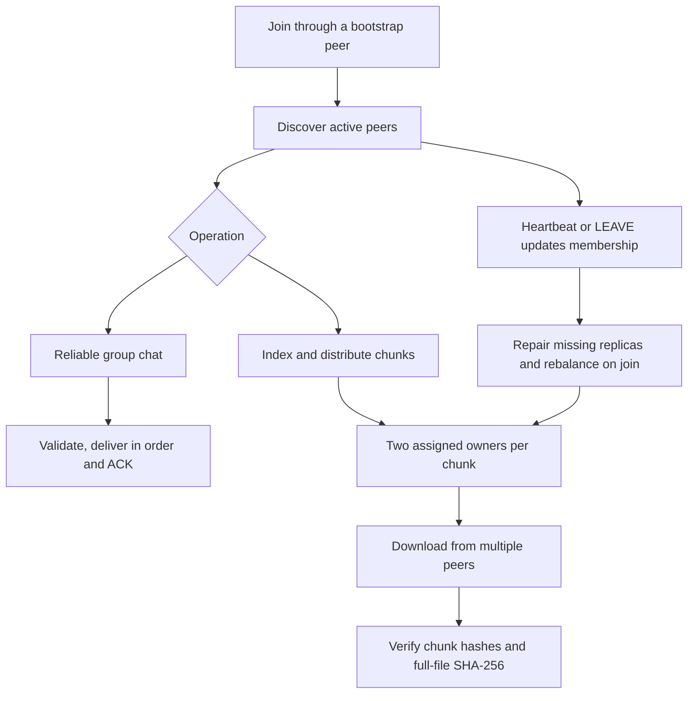

<div align="center">

# P2P · UDP Chat & Distributed File Sharing

**Reliable chat. Replicated chunks. Multi-source downloads.**

A Computer Networks project built with Python sockets and an application-layer reliability protocol over UDP.

[Quick start](#quick-start) · [Commands](#terminal-commands) · [How it works](#how-it-works) · [Tests](#verification) · [Evidence](#project-documents)

</div>

---

## At a glance

| Component | Current implementation |
|---|---|
| Network | Peer-to-peer IPv4 UDP; bootstrap-assisted discovery |
| Protocol | Version 2 · 20-byte binary header · maximum 1,024-byte datagram |
| Chat | Per-recipient sessions, exact ACKs, retransmission, duplicate suppression and ordered delivery |
| Storage | 256 KiB chunks, two assigned owners per chunk, bounded HRW placement |
| Downloads | Up to four parallel chunk workers, alternate-source recovery and SHA-256 verification |
| Dependencies | Python 3 and its standard library; no third-party packages required |

**Latest recorded integration result:** passed on **25 November 2026**, covering four initial localhost peers and a fifth late joiner. This is a local demonstration; four-machine LAN operation and broad packet-loss testing remain outstanding.

## Quick start

### 1. Get the project

```bash
git clone https://github.com/usman-irshad1/p2p.git
cd p2p
```

The examples use `python`. On systems where Python 3 is named `python3`, substitute that command.

### 2. Start four peers

Open four terminals in the project directory. Start the bootstrap peer first:

```bash
python p2p_file.py 5000
```

Then run one additional peer per terminal:

```bash
python p2p_file.py 5001 127.0.0.1:5000
python p2p_file.py 5002 127.0.0.1:5000
python p2p_file.py 5003 127.0.0.1:5000
```

Wait for membership to settle before indexing files. Type ordinary text into a peer terminal to send a group chat message. Press **Ctrl+C** to leave gracefully.

### 3. Share and download a file

On a sharing peer:

```text
/index "/absolute/path/to/shared-file.bin"
/files
```

On Windows, a path such as `/index "C:\Users\YourName\Documents\shared-file.bin"` also works.

Copy the 64-character file ID from the catalog, then use another peer:

```text
/download FILE_ID_HEX
```

The reconstructed file is saved to `downloads/<catalog-filename>` unless an output path is supplied. Downloads use private temporary staging; downloading a complete file does not advertise every chunk as a stored replica.

For the assignment demonstration, use **at least four peers** and files large enough to contain several chunks. Placement requires at least three joined peers; with only three peers, a two-chunk file cannot satisfy both two replicas per chunk and the rule that no peer stores the complete file.

### Running on separate computers

All participants must use the same current code and protocol version. Replace the loopback address with the bootstrap machine's reachable LAN IPv4 address:

```bash
# Bootstrap machine — example LAN address
python p2p_file.py 5000 --ip 192.168.1.10

# Another machine — example LAN address
python p2p_file.py 5001 192.168.1.10:5000 --ip 192.168.1.11
```

Use your machines' actual addresses. Permit inbound UDP on each peer's chosen port in the host firewall. The program binds to `0.0.0.0` and can detect its advertised address; `--ip` overrides that choice. Loopback (`127.0.0.1`) connects only peers on the same computer. NAT traversal is not implemented.

## Terminal commands

| Input | Action |
|---|---|
| Any ordinary text | Queue a CHAT for every currently active recipient |
| `/files` | Show known files and chunk ownership |
| `/index "PATH"` | Hash a file, split it into chunks and request distributed replicas |
| `/download FILE_ID_HEX` | Fetch and reconstruct a catalog file in `downloads/` |
| `/download FILE_ID_HEX "OUTPUT_PATH"` | Reconstruct the file at a chosen destination |
| Ctrl+C | Send LEAVE and stop the peer |

Each peer stores chunks separately under `peer_chunks/<port>/`. Set the `P2P_STORE_DIR` environment variable before startup to choose a different base directory. Peer lists, catalog metadata and transfer queues are maintained in memory.

## How it works



### Reliable chat

- Each recipient has an independent stream and an eight-packet sending window.
- Version 2 CHAT payloads contain a session ID, a chat sequence and UTF-8 text, with a **996-byte text limit**.
- Receivers validate the version, checksum, lengths, sequence fields and UTF-8 before acknowledging a CHAT.
- Expected messages display once. Recognized duplicates are ACKed again; future messages are discarded without an ACK and recovered by retransmission.
- RTO begins at 1 second, adapts from unambiguous ACK timings and is clamped to 0.2–3 seconds. Heartbeats run every 2 seconds; a peer times out after 6 seconds.

See [Reliable Ordered Chat Rules](RELIABLE_CHAT_RULES.md) for session resets, ordering and retry semantics.

### Distributed file transfer

- Bounded highest-random-weight (HRW) placement selects two distinct owners per chunk while avoiding a complete-file replica on one peer.
- FILE_LIST, CHUNK_HASH and CHUNK_HAVE messages have matching acknowledgements and bounded retries.
- Chunk receivers verify SHA-256 before storing or advertising a chunk. The completed download is checked against the full-file SHA-256 ID.
- Downloads prefer rare chunks, use a sliding pool of up to four workers and cap planned source concurrency at two per source.
- Ranged CHUNK_REQUEST packets support resume offsets. CHUNK_ACK tracks selective fragment receipt; CHUNK_NAK reports missing, busy or corrupt sources.
- On departure or timeout, surviving owners coordinate replica repair. Late joiners fetch their assigned chunks, retrying with refreshed owner lists; older replicas are retained.

<details>
<summary><strong>Current transfer settings</strong></summary>

| Setting | Value in code |
|---|---:|
| Chunk size | 256 KiB |
| Selective fragment window | 32 fragments |
| Maximum fragment send rounds | 8 |
| Burst pacing | 4 fragments, then 5 ms pause |
| Minimum chunk RTO | 0.5 seconds |
| Simultaneous outgoing chunk transfers per peer | 1; additional requests receive BUSY |
| Requested UDP receive buffer | 4 MiB; the operating system may clamp it |
| FILE_LIST / CHUNK_HASH / CHUNK_HAVE retry timeout | 1 second |
| Retries for each of those control messages | 5 |

These are implementation settings, not measured throughput guarantees.

</details>

## Verification

Run the unit suite:

```bash
python -m unittest discover -s tests -v
```

Run the protocol's built-in checks:

```bash
python protocol_design.py
```

Run the complete localhost checker:

```bash
python integration_test.py
```

The top-level checker runs the unit suite, chooses free consecutive UDP ports and launches `tests/integration_test.py`. Set `P2P_TEST_PORT` if a specific base port is required. Test files and peer stores are temporary; timing results are written to `output/integration_metrics.csv`.

| Recorded coverage | Result |
|---|---|
| Protocol, chat-session, placement and failover unit suite | 17 tests passed |
| Four-peer membership and ordered chat | Passed |
| Two 2.5 MB files indexed by each of five peers | Passed |
| Replica placement without a complete-file owner | Passed |
| Fifth-peer late-join rebalancing | Passed |
| Deliberately dropped CHUNK_DATA fragment and retransmission | Passed |
| Simulated BUSY response | Passed |
| Corrupt stored chunk and fallback to a valid replica | Passed |
| Multi-source download and full-file SHA-256 | Passed |
| Source crash, download recovery, timeout removal and replica repair | Passed |

The table summarizes the recorded successful integration run and its evidence. It does not establish reliability across every loss pattern or real LAN deployment.

### Saved localhost measurements

The repository already contains these values in [integration_metrics.csv](output/integration_metrics.csv). They describe one recorded run, not general benchmarks.

| Measurement | Recorded value |
|---|---:|
| Chat broadcast delivery | 0.101 seconds |
| 2.5 MB multi-source download | 1.706 seconds |
| Download throughput | 1.397 MiB/s |
| Corrupt-replica fallback | 1.524 seconds |
| Source-crash download recovery | 8.087 seconds |

Repeatable multi-run measurements and report graphs remain to be prepared.

## Project documents

| File | Purpose |
|---|---|
| [p2p_file.py](p2p_file.py) | Live peer, membership, chat, transfer scheduling and repair |
| [protocol_design.py](protocol_design.py) | Active binary protocol encoder, validators and self-tests |
| [file_catalog.py](file_catalog.py) | File metadata, chunk hashes and ownership tracking |
| [chunk_store.py](chunk_store.py) | Chunk storage and file assembly |
| [protocol.md](protocol.md) | Protocol design reference |
| [RELIABLE_CHAT_RULES.md](RELIABLE_CHAT_RULES.md) | Reliable ordered chat specification |
| [FIXES.md](FIXES.md) | Fix history and known implementation limitations |
| [tests/test_fixes.py](tests/test_fixes.py) | Unit regression tests |
| [tests/integration_test.py](tests/integration_test.py) | Live multi-peer integration scenarios |
| [Debugging evidence](evidence/p2p_debug_outputs.pdf) | Terminal screenshots; successful integration evidence on pages 34–37 |
| [Protocol design report](output/pdf/CN_A-3_P2P_Protocol_Design_Project_Aligned_v2.pdf) | Project-aligned protocol report |

Use `protocol_design.py` for the active implementation; the similarly named file containing a space is a separate legacy copy.

## Remaining work and limitations

- [ ] Demonstrate the complete workflow on four actual participant machines and verify LAN/firewall behavior.
- [ ] Simulate loss of FILE_LIST, CHUNK_HASH and CHUNK_HAVE packets and their acknowledgements. Current deliberate loss coverage targets CHUNK_DATA.
- [ ] Test simultaneous joins, peer-ID collisions, peer-list overflow and larger groups.
- [ ] Exercise real outgoing-transfer-slot saturation in addition to the simulated BUSY response.
- [ ] Collect repeated performance measurements, prepare graphs and finish submission/demo packaging.

Join rebalancing retains surplus replicas; safe removal of extra copies is not implemented. Chat sequence counters do not wrap: a stream stops after 65,535 messages to one recipient. Catalog and membership state are not persistent. Checksums and SHA-256 detect corruption; they do not provide encryption or authenticate peers.
