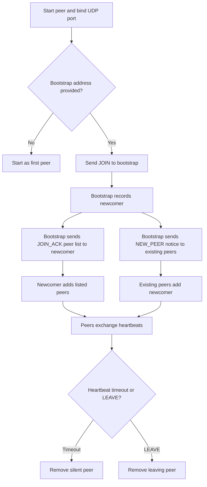
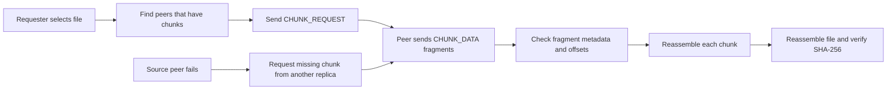

# P2P UDP Group Chat and File Sharing

A student project to build a multi-peer group chat and file-sharing application over UDP, without a permanent central server. A running peer can act as the bootstrap contact for newcomers.

## Current project checklist

### Implemented or prototyped

- [x] Python UDP socket setup and command-line local port/bootstrap address.
- [x] Peer ID generation using a 16-bit random value.
- [x] Bootstrap join message and JOIN_ACK response containing known peer IDs, IP addresses, and ports.
- [x] `new_peer` notification so existing peers can add a newcomer to their peer lists.
- [x] A 20-byte application header format using network byte order: `!HHBBHIHHHH`.
- [x] Packet type IDs assigned for JOIN, CHAT, CHUNK_REQUEST, LEAVE, HEARTBEAT, ACK, JOIN_ACK, CHUNK_DATA, FILE_LIST, CHUNK_HAVE, and REPLICATE_REQ.
- [x] Payload helpers/prototypes for chat text, chunk requests, chunk data fragments, and chunk availability.
- [x] SHA-256 file ID helper.
- [x] Local CHUNK_DATA fragmentation/reassembly demonstration: two 500-byte fragments reassembled into the original 1,000-byte chunk.
- [x] Local peer discovery/heartbeat demonstration with three localhost peers.
- [x] Local timeout demonstration showing a silent peer removed after its heartbeat timeout.

### Still to implement or integrate

- [x] Heartbeat tracking and timeout removal are now present in the pushed `p2p_file.py`; the three-peer localhost screenshots show a silent peer being removed after its timeout.
- [x] Add a graceful LEAVE message; recipients remove the leaving peer immediately. The three-peer localhost screenshots show the peer list updating after LEAVE.
- [ ] Integrate the binary packet header and packet type handling from `protocol_design.py` into the live UDP peer program. Peer discovery currently uses text messages.
- [ ] Implement reliable group chat over UDP: per-peer/directional sequence tracking, acknowledgments, retransmission, duplicate suppression, and in-order delivery.
- [ ] Implement a real file catalog and chunk ownership announcements.
- [ ] Transfer actual file chunks between peers, save received chunks, reassemble complete files, and verify file integrity.
- [ ] Store each chunk on at least two peers to meet the project's redundancy requirement.
- [ ] Implement multi-source downloads that fetch chunks from at least two peers in parallel.
- [ ] Test failover by stopping a chunk source during a download and completing from another replica.
- [ ] Test with at least four peers and record measured results/graphs for the project report.
- [ ] Package the report, source code, and run instructions for submission and prepare the live demonstration.

## Run the current localhost peer discovery prototype

Open separate terminals in the project folder.

First peer:

```powershell
python p2p_file.py 5000
```

Additional peers:

```powershell
python p2p_file.py 5001 127.0.0.1:5000
python p2p_file.py 5002 127.0.0.1:5000
```

These commands are for testing multiple peers on one computer. The code's advertised address is currently `127.0.0.1`; peers on separate computers need a reachable LAN address instead.

## Workflows

### Current peer membership workflow

The current `p2p_file.py` membership messages are text-based. A newcomer contacts one bootstrap peer, then that peer shares the newcomer's endpoint with its existing peers.



### Planned reliable chat workflow

The flow below describes the intended binary protocol behavior. Reliable, ordered chat is not integrated into the live peer program yet.

```mermaid
sequenceDiagram
    participant S as Sending peer
    participant R as Receiving peer
    S->>R: CHAT with packet sequence and chat sequence
    R->>R: Check duplicate and ordering
    R-->>S: ACK with the exact packet sequence
    R->>R: Deliver chat text once in order
    Note over S,R: On ACK timeout, sender retransmits; receiver deduplicates.
```

### Planned file download workflow



## Graphs

These are configuration and local-demo values, not performance benchmarks.

Heartbeat settings in the current peer program (each `#` represents one second):

```text
Heartbeat interval  #####               5 seconds
Peer timeout        ###############    15 seconds
```

Local CHUNK_DATA reassembly demo sizes:

```text
Fragment 1          ##########          500 bytes
Fragment 2          ##########          500 bytes
Reassembled chunk   #################### 1,000 bytes
```

Measured performance graphs still need real test data. Planned graphs include chat delivery latency vs. peer count, file throughput vs. file size, and recovery time after a chunk source is stopped during a download.

## Current limitations

- The discovery program and binary protocol prototype are separate files and are not yet one integrated application.
- UDP does not guarantee delivery. The chat and file-transfer reliability features remain to be implemented.
- The peer list is currently in memory; it is not persistent.
- Localhost tests do not establish that peers can connect across different networks or through NAT.

## Evidence log

Debugging screenshots and local test results are being collected in the running PDF: `p2p_debug_outputs.pdf`.
