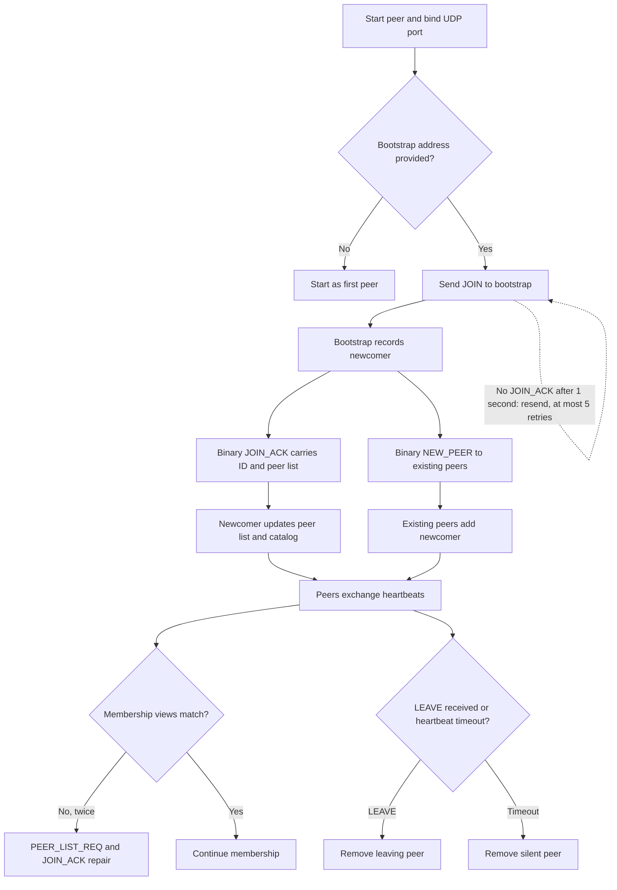
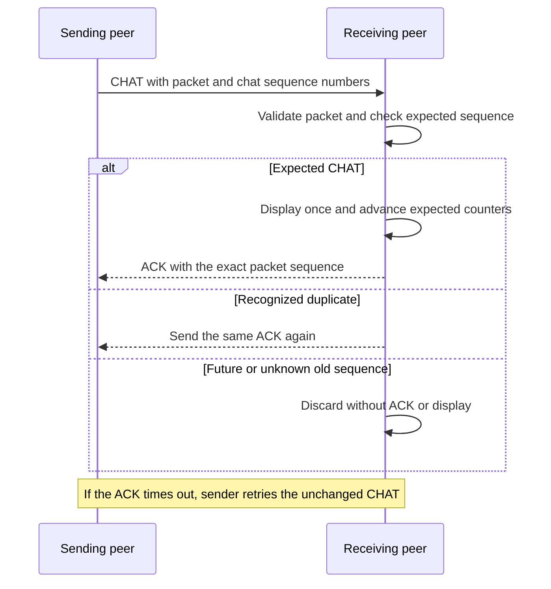

# P2P UDP Group Chat and File Sharing

A student project to build a multi-peer group chat and file-sharing application over UDP. Peers can use a bootstrap peer to discover the group; the bootstrap peer is not intended to remain a central server.

## Project status

**Status:** The PDF's small-group protocol improvements are implemented in code and documented; live multi-peer verification is still pending. Placement uses bounded HRW hashing, downloads use ranged requests with resume/failover and a sliding worker pool, and peers compare membership-view hashes.

### Implemented or prototyped

- [x] UDP peer startup with a command-line port and optional bootstrap address.
- [x] Peer IDs, join, peer-list response, and new-peer notifications.
- [x] Heartbeats, peer timeout removal, and graceful LEAVE handling.
- [x] A 20-byte application header using network byte order: `!HHBBHIHHHH`.
- [x] Packet type IDs and payload helpers for JOIN, CHAT, ranged CHUNK_REQUEST, LEAVE, HEARTBEAT, ACK, JOIN_ACK, CHUNK_DATA, FILE_LIST, FILE_LIST_ACK, CHUNK_HAVE, CHUNK_HAVE_ACK, REPLICATE_REQ, NEW_PEER, CHUNK_ACK, CHUNK_NAK, CHUNK_HASH, CHUNK_HASH_ACK, and PEER_LIST_REQ.
- [x] CHUNK_ACK selective acknowledgements now drive 32-fragment send windows with bounded retransmission; CHUNK_NAK reports missing or corrupt chunks and lets downloads try another owner.
- [x] Peers exchange a SHA-256 digest for each chunk; incoming chunks are checked before they are stored or advertised.
- [x] CHUNK_HASH delivery retries the same digest packet after one second, up to five times, until the matching CHUNK_HASH_ACK arrives.
- [x] FILE_LIST records are acknowledged per file and retried after one second, up to five times, if the FILE_LIST_ACK is lost.
- [x] CHUNK_HAVE ownership announcements are acknowledged and retried after one second, up to five times, if the matching CHUNK_HAVE_ACK is lost.
- [x] Checksum and packet validation helpers, including CHAT and ACK validation.
- [x] Local CHUNK_DATA fragmentation and reassembly demonstration: two 500-byte fragments rebuild a 1,000-byte chunk.
- [x] Reliable ordered chat logic in `p2p_file.py`: per-peer queues, exact ACK matching, an eight-packet window, adaptive retransmission timing, duplicate suppression, and in-order acceptance.
- [x] In-memory checks passed for Rules 6 and 7: duplicates are ACKed but not displayed twice, out-of-order messages are rejected, and peer removal clears chat and sequence state.
- [x] Live FILE_LIST and CHUNK_HAVE catalog exchange on peer join, plus `/files` to inspect known metadata and chunk owners.
- [x] `chunk_store.py` writes individual chunks to disk and rebuilds a file in order with a full-file SHA-256 check.
- [x] `/index <path>` splits a file into 256 KiB chunks; bounded HRW placement selects two distinct owners per chunk from at least three known peers and avoids assigning every chunk to one peer.
- [x] `/download <file_id_hex> [output_path]` uses a sliding pool of up to four chunk workers, prefers rare chunks, caps planned concurrent downloads at two per source, and verifies the rebuilt file's SHA-256.
- [x] CHUNK_REQUEST carries a start offset and length so a download can resume at the first missing byte; a source change is attempted after three adaptive RTOs without progress.
- [x] CHUNK_DATA transmission pauses briefly after each eight-fragment burst; the UDP socket requests a 4 MiB receive buffer (the operating system may clamp this value).
- [x] Live CHUNK_ACK/CHUNK_NAK handling: receivers report cumulative progress and selective fragment receipt; each 32-fragment window gets up to five send rounds, and a missing chunk triggers NOT_STORED.
- [x] On LEAVE or heartbeat timeout, the lowest-ID surviving owner asks an unassigned peer to copy an under-replicated chunk; repair requests retry until a replacement owner is announced.
- [x] When a peer joins, it computes its assigned share and fetches missing chunks from known owners; old replicas are retained, so this is additive rebalancing.
- [x] Heartbeats include a CRC-32 membership-view hash; two consecutive mismatches trigger a binary PEER_LIST_REQ and JOIN_ACK snapshot exchange.
- [x] Bootstrap peers assign joining peer IDs from their currently known active IDs.
- [x] Membership uses binary JOIN, JOIN_ACK, NEW_PEER, HEARTBEAT, LEAVE, and PEER_LIST_REQ datagrams; JOIN is retried and deduplicated by UDP source address.
- [x] Local screenshots show peers joining and receiving sequential chat messages. Evidence is collected in [the debugging PDF](evidence/p2p_debug_outputs.pdf).

### Remaining for the full assignment

- [ ] Run a live transfer with packet loss to check FILE_LIST, CHUNK_HASH, and CHUNK_HAVE retries, selective fragment retry, and NOT_STORED failover; save terminal screenshots as evidence.
- [ ] Corrupt a test chunk or digest and verify the receiver rejects it and tries another owner; save terminal screenshots as evidence.
- [ ] Run a live four-peer check of catalog exchange, replica placement, download, and the latest Rule 6/7 chat changes; save screenshots as evidence.
- [x] Replace text membership messages with binary protocol packets; live multi-peer and packet-loss verification remains pending.
- [ ] Prepare at least two files of 2 MB or larger; split them into fixed-size chunks.
- [ ] Verify live that each chunk has two owners and no peer's chunk store holds the complete file.
- [x] Implement automatic re-replication after an owner leaves or times out; live verification remains pending.
- [x] Let a joining peer take its assigned share of existing chunks; live verification remains pending, and older copies are not deleted.
- [ ] Demonstrate a multi-source download with chunks coming from at least two peers.
- [ ] Test source failure during download and continue from another replica.
- [ ] Demonstrate the application with at least four peers and record measured results and graphs for the report.
- [ ] Finish submission packaging, run instructions, and live demonstration preparation.

## Run peer discovery locally

Open separate PowerShell terminals in the project directory.

Start the first peer:

```powershell
python p2p_file.py 5000
```

Start additional peers:

```powershell
python p2p_file.py 5001 127.0.0.1:5000
python p2p_file.py 5002 127.0.0.1:5000
python p2p_file.py 5003 127.0.0.1:5000
```

These commands run peers on one computer. The current advertised address is `127.0.0.1`; peers on separate computers need a reachable LAN address.

In a peer terminal, share a file and inspect the catalog:

```text
/index "C:\\path\\to\\shared-file.bin"
/files
```

Copy the 64-character file ID printed by `/index` or `/files`, then download it on another peer:

```text
/download FILE_ID_HEX
```

For the assignment demo, start at least four peers before indexing files. The code can place chunks with three known peers, but four peers remain the project target. By default, the reconstructed file is saved under `downloads/` using its catalog filename. The source keeps temporary chunks until both assigned peers announce their copies; interrupted replication can leave temporary source chunks behind.

## Workflows

### Peer discovery and membership

Membership control uses binary protocol packets. A newcomer retries JOIN to its configured bootstrap until JOIN_ACK assigns an ID and returns the known peer list. The bootstrap announces it to existing peers with NEW_PEER; heartbeats can also introduce a peer if that announcement was lost. Repeated membership-view mismatches trigger a peer-list request.



### Reliable chat

The sender maintains an independent ordered chat stream for each recipient, with up to eight CHAT packets outstanding. Each receiver validates CHAT packets, accepts only the next expected message, ACKs recognized duplicates without displaying them again, and rejects out-of-order packets without an ACK. Per-peer RTO adapts from unambiguous ACK timings.



Rule 6/7 in-memory verification passed. The latest changes still need a live UDP check across peer processes.

### File placement and basic download


## Current measurements and graphs

The current values below are configuration and local demonstrations, not performance benchmarks.

Heartbeat settings (each `#` represents one second):

```text
Heartbeat interval  ##                  2 seconds
Peer timeout        ######              6 seconds
```

Local CHUNK_DATA reassembly demonstration:

```text
Fragment 1          ##########          500 bytes
Fragment 2          ##########          500 bytes
Reassembled chunk   #################### 1,000 bytes
```

Measured performance graphs still need real test data. Planned graphs include chat delivery latency by peer count, file throughput by file size, and recovery time after a chunk source is stopped.

## Current limitations

- Membership uses binary packets. Multi-peer, packet-loss, simultaneous-join, and oversized peer-list behavior still need live verification. JOIN_ACK peer lists currently fit in a single datagram only.
- Placement currently runs when `/index` is entered and needs at least three known peers and two chunks. A file indexed before the group is ready must be indexed again after peers join.
- CHUNK_ACK/CHUNK_NAK, CHUNK_HASH/CHUNK_HASH_ACK, FILE_LIST/FILE_LIST_ACK, and CHUNK_HAVE/CHUNK_HAVE_ACK are connected to the live transfer loop, but packet-loss recovery, hash mismatch handling, and adaptive failover still need live testing. NOT_STORED and HASH_MISMATCH are the active NAK reasons.
- Join-time rebalancing retains old replicas. Safe surplus-copy deletion is not implemented because membership views and replacement ownership still need live verification.
- The peer list and reliability state exist only in memory.
- The advertised `127.0.0.1` address supports same-computer testing, not communication between separate computers.

## Protocol and evidence documents

- [protocol.md](protocol.md) documents the application-layer packet design.
- [RELIABLE_CHAT_RULES.md](RELIABLE_CHAT_RULES.md) specifies reliable ordered chat behavior.
- [Debugging evidence PDF](evidence/p2p_debug_outputs.pdf) contains terminal screenshots and captions. Add new screenshots after live catalog and file-transfer checks.
