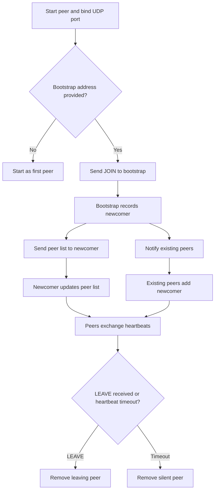
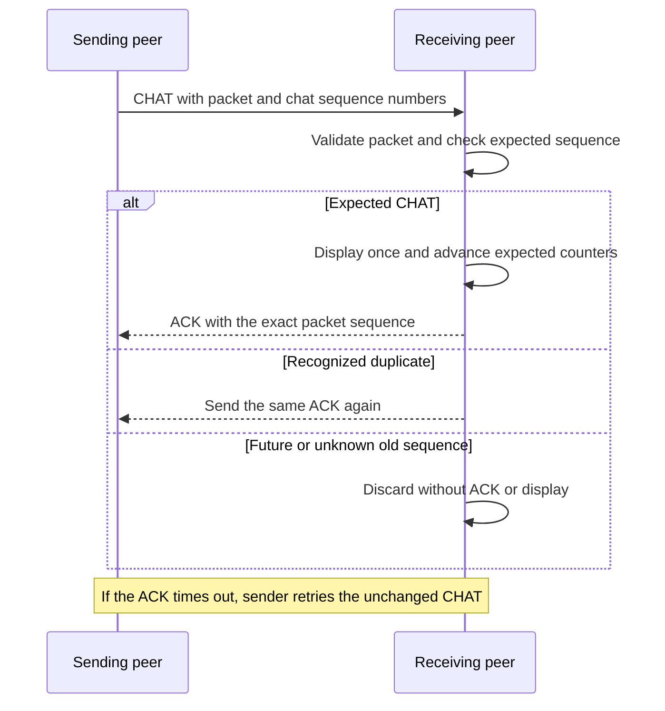

# P2P UDP Group Chat and File Sharing

A student project to build a multi-peer group chat and file-sharing application over UDP. Peers can use a bootstrap peer to discover the group; the bootstrap peer is not intended to remain a central server.

## Project status

**Approximate implementation coverage: 90%.** A joining peer now fetches the chunks assigned to it by the balanced placement plan. File placement, transfer, and repair still need live multi-peer checks; treat this percentage as a planning estimate until the four-peer demo succeeds.

### Implemented or prototyped

- [x] UDP peer startup with a command-line port and optional bootstrap address.
- [x] Peer IDs, join, peer-list response, and new-peer notifications.
- [x] Heartbeats, peer timeout removal, and graceful LEAVE handling.
- [x] A 20-byte application header using network byte order: `!HHBBHIHHHH`.
- [x] Packet type IDs and payload helpers for JOIN, CHAT, CHUNK_REQUEST, LEAVE, HEARTBEAT, ACK, JOIN_ACK, CHUNK_DATA, FILE_LIST, CHUNK_HAVE, REPLICATE_REQ, NEW_PEER, CHUNK_ACK, CHUNK_NAK, and CHUNK_HASH.
- [x] CHUNK_ACK selective acknowledgements now drive 32-fragment send windows with bounded retransmission; CHUNK_NAK reports missing or corrupt chunks and lets downloads try another owner.
- [x] Peers exchange a SHA-256 digest for each chunk; incoming chunks are checked before they are stored or advertised.
- [x] Checksum and packet validation helpers, including CHAT and ACK validation.
- [x] Local CHUNK_DATA fragmentation and reassembly demonstration: two 500-byte fragments rebuild a 1,000-byte chunk.
- [x] Reliable ordered chat logic in `p2p_file.py`: per-peer queues, exact ACK matching, retransmission of the same CHAT after one second, duplicate suppression, and in-order acceptance.
- [x] In-memory checks passed for Rules 6 and 7: duplicates are ACKed but not displayed twice, out-of-order messages are rejected, and peer removal clears chat and sequence state.
- [x] Live FILE_LIST and CHUNK_HAVE catalog exchange on peer join, plus `/files` to inspect known metadata and chunk owners.
- [x] `chunk_store.py` writes individual chunks to disk and rebuilds a file in order with a full-file SHA-256 check.
- [x] `/index <path>` splits a file into 256 KiB chunks; with at least four peers, it assigns two distinct peers per chunk and asks remote owners to copy their assigned chunks.
- [x] `/download <file_id_hex> [output_path]` requests chunks in parallel batches of four and verifies the rebuilt file's SHA-256.
- [x] CHUNK_REQUEST and fragmented CHUNK_DATA transfer are connected to the live UDP message loop; each request is sent up to three times, and temporary source copies are removed after both assigned peers announce ownership.
- [x] Live CHUNK_ACK/CHUNK_NAK handling: receivers report cumulative progress and selective fragment receipt; each 32-fragment window gets up to five send rounds, and a missing chunk triggers NOT_STORED.
- [x] On LEAVE or heartbeat timeout, the lowest-ID surviving owner asks an unassigned peer to copy an under-replicated chunk; repair requests retry until a replacement owner is announced.
- [x] When a peer joins, it computes its assigned share and fetches missing chunks from known owners; old replicas are retained, so this is additive rebalancing.
- [x] Local screenshots show peers joining and receiving sequential chat messages. Evidence is collected in [the debugging PDF](evidence/p2p_debug_outputs.pdf).

### Remaining for the full assignment

- [ ] Run a live transfer with packet loss to check selective fragment retry and NOT_STORED failover; save terminal screenshots as evidence.
- [ ] Corrupt a test chunk or digest and verify the receiver rejects it and tries another owner; save terminal screenshots as evidence.
- [ ] Run a live four-peer check of catalog exchange, replica placement, download, and the latest Rule 6/7 chat changes; save screenshots as evidence.
- [ ] Replace the remaining text-based membership messages with the specified binary protocol packets.
- [ ] Prepare at least two files of 2 MB or larger; split them into fixed-size chunks.
- [ ] Verify live that each chunk has two owners and no peer's chunk store holds the complete file.
- [x] Implement automatic re-replication after an owner leaves or times out; live verification remains pending.
- [x] Let a joining peer take its assigned share of existing chunks; live verification remains pending, and older copies are not deleted.
- [ ] Demonstrate a multi-source download with chunks coming from at least two peers.
- [ ] Test source failure during download and continue from another replica.
- [ ] Demonstrate the application with at least four peers and record measured results and graphs for the report.
- [ ] Finish submission packaging, run instructions, and live demonstration preparation.

## Run peer discovery locally

Open separate PowerShell terminals in the project directory.

Start the first peer:

```powershell
python p2p_file.py 5000
```

Start additional peers:

```powershell
python p2p_file.py 5001 127.0.0.1:5000
python p2p_file.py 5002 127.0.0.1:5000
python p2p_file.py 5003 127.0.0.1:5000
```

These commands run peers on one computer. The current advertised address is `127.0.0.1`; peers on separate computers need a reachable LAN address.

In a peer terminal, share a file and inspect the catalog:

```text
/index "C:\\path\\to\\shared-file.bin"
/files
```

Copy the 64-character file ID printed by `/index` or `/files`, then download it on another peer:

```text
/download FILE_ID_HEX
```

Index a file after all four peers have joined so it can assign replicas. By default, the reconstructed file is saved under `downloads/` using its catalog filename. The source keeps temporary chunks until both assigned peers announce their copies; interrupted replication can leave temporary source chunks behind.

## Workflows

### Peer discovery and membership

Membership control messages are currently text-based. A newcomer contacts a bootstrap peer, receives its peer list, and is announced to the other peers.



### Reliable chat

The sender maintains an independent stop-and-wait chat stream for each recipient. Each receiver validates CHAT packets, accepts only the expected sequence, ACKs recognized duplicates without displaying them again, and rejects out-of-order packets without an ACK.



Rule 6/7 in-memory verification passed. The latest changes still need a live UDP check across peer processes.

### File placement and basic download

```mermaid
flowchart LR
    A[Indexer creates placement and chunk SHA-256 hashes] --> B[Send FILE_LIST, CHUNK_HASH, and local CHUNK_HAVE]
    B --> C[Send REPLICATE_REQ to assigned remote owners]
    C --> D[Remote owners request their assigned chunks]
    D --> E[Source sends CHUNK_DATA fragments]
    E --> F[Receiver ACKs fragments and verifies chunk hash]
    F --> F2[Store valid chunk and announce CHUNK_HAVE]
    F2 --> G[Requester fetches chunks in parallel batches of four]
    G --> H[Rebuild file and verify SHA-256]
```



## Current measurements and graphs

The current values below are configuration and local demonstrations, not performance benchmarks.

Heartbeat settings (each `#` represents one second):

```text
Heartbeat interval  #####               5 seconds
Peer timeout        ###############    15 seconds
```

Local CHUNK_DATA reassembly demonstration:

```text
Fragment 1          ##########          500 bytes
Fragment 2          ##########          500 bytes
Reassembled chunk   #################### 1,000 bytes
```

Measured performance graphs still need real test data. Planned graphs include chat delivery latency by peer count, file throughput by file size, and recovery time after a chunk source is stopped.

## Current limitations

- Membership control is still text-based; the binary packet helpers are not integrated for every message type.
- Placement currently runs when `/index` is entered, and needs at least four joined peers and at least two chunks. A file indexed before the group is ready must be indexed again after peers join.
- CHUNK_ACK/CHUNK_NAK and per-chunk hash verification are connected to the live transfer loop, but packet-loss recovery, hash mismatch handling, and failover still need live testing. NOT_STORED and HASH_MISMATCH are the active NAK reasons.
- The peer list and reliability state exist only in memory.
- The advertised `127.0.0.1` address supports same-computer testing, not communication between separate computers.

## Protocol and evidence documents

- [protocol.md](protocol.md) documents the application-layer packet design.
- [RELIABLE_CHAT_RULES.md](RELIABLE_CHAT_RULES.md) specifies reliable ordered chat behavior.
- [Debugging evidence PDF](evidence/p2p_debug_outputs.pdf) contains terminal screenshots and captions. Add new screenshots after live catalog and file-transfer checks.
